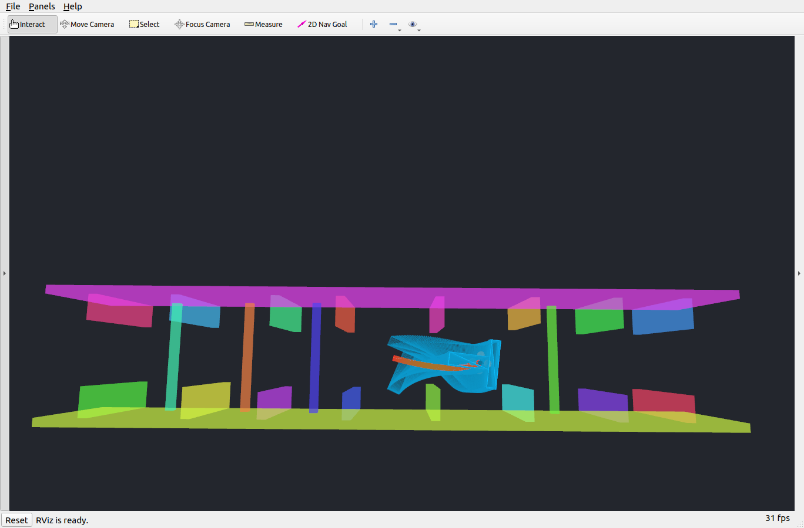

# Arbitrary Geometry Planner

Known-map trajectory planning for non-spherical bodies, jointly planning three-dimensional position and yaw. This release contains the shape-aware search frontend, trajectory optimization backend, ROS1 simulation, RViz interface, and prepared map and body geometry.

PolyMap construction, geometry generation, competing planners, real-world experiment assets, and manuscript sources are outside this release. The supplied final maps and shapes can be loaded directly; no map-building step is required.



## Requirements and build

Use Ubuntu 20.04, ROS1 Noetic, and system Python 3.8. Install ROS Noetic before running the following commands. Run all commands from the repository root.

```bash
git clone https://github.com/Chai8226/ArbitraryGemometryPlanner.git
cd ArbitraryGemometryPlanner
sudo apt-get update
sudo apt-get install build-essential cmake curl python3-catkin-tools python3-yaml \
  ros-noetic-roscpp ros-noetic-rospy ros-noetic-roslib ros-noetic-roslaunch \
  ros-noetic-rviz ros-noetic-pcl-conversions ros-noetic-tf2-geometry-msgs \
  ros-noetic-message-generation libeigen3-dev libpcl-dev \
  libccd-dev liboctomap-dev tmux tmuxp
bash mighty_ws/src/mighty/setup.sh -j 4
```

The setup script builds `dynus_interfaces` and `mighty` with system compilers and Python. On first use it downloads and builds FCL 0.7.0 and nlohmann/json 3.10.5; this requires network access. Generated dependencies and build products stay under `mighty_ws/` and are excluded from Git.

## Run

```bash
bash mighty_ws/src/mighty/scripts/noetic_env.sh \
  /usr/bin/python3 mighty_ws/src/mighty/scripts/run_known_map.py \
  --map hole --shape t
```

In RViz, use **2D Nav Goal** to choose a goal. The shipped planner configuration fixes goal height at 1 m (`force_goal_z: true`); edit `mighty_ws/src/mighty/config/params/mighty_node.yaml` to use the requested goal height instead. RViz goal orientation specifies terminal yaw.

| Map | Shape set | Available `--shape` values |
| --- | --- | --- |
| `hole` | `small` | `cuboid`, `cross`, `t`, `v`, `long1`, `long2` |
| `forest`, `narrow`, `block` | `normal` | `cuboid`, `cross`, `t`, `v` |

Run a specified task without RViz:

```bash
bash mighty_ws/src/mighty/scripts/noetic_env.sh \
  /usr/bin/python3 mighty_ws/src/mighty/scripts/run_known_map.py \
  --map narrow --shape t --start 0 0 1 --start-yaw 0 \
  --goal 2.27 -0.11 1 --no-rviz --detached
```

Coordinates are in metres. `--start-yaw` and `--goal-yaw` are in degrees; `--goal-yaw` requires `--goal`. Omitting `--goal-yaw` leaves terminal yaw to the planner. The default initial yaw is zero. The simulator follows the resulting position-and-yaw trajectory; this release runs in `global_once + known_pcd + fake_sim` mode.

The launcher creates the `mighty_known_map` tmux session. Use `tmux attach -t mighty_known_map` to inspect it and `tmux kill-session -t mighty_known_map` to stop it. A pre-existing session is rejected unless explicitly replaced with `--kill-stale`; replacement checks ownership by checkout.

## Validation and evaluation

Run the configuration, gradient, and offline planner regression checks after building:

```bash
(cd mighty_ws/build/mighty && /usr/bin/ctest --output-on-failure)
```

For a ROS execution check, start an isolated master in one terminal:

```bash
bash mighty_ws/src/mighty/scripts/noetic_env.sh roscore -p 11321
```

In another terminal, from the repository root:

```bash
ROS_MASTER_URI=http://localhost:11321 \
bash mighty_ws/src/mighty/scripts/noetic_env.sh \
  /usr/bin/python3 mighty_ws/src/mighty/test/validate_noetic_runtime.py \
  --representatives-only --results /tmp/arbitrary-geometry-ros
```

This selects one representative task per map and checks ROS startup, map publication, trajectory execution, arrival, and node shutdown. It does not launch RViz. Measured release checks and their limits are recorded in [validation results](docs/validation.md).

For an offline benchmark task:

```bash
bash mighty_ws/src/mighty/scripts/run_quantitative_test.sh \
  --case narrow-t --pair-limit 1 --results /tmp/arbitrary-geometry-results
```

The offline benchmark uses the built ROS environment for messages and executable discovery but does not require running ROS nodes. It writes JSON, CSV, and HTML reports. Offline planning and simulated arrival are separate checks; neither establishes real-hardware performance.

## Configuration and assets

- `mighty_ws/src/mighty/config/mighty.yaml`: map, shape, task, and vehicle selections.
- `mighty_ws/src/mighty/config/params/mighty_node.yaml`: search, optimization, and motion constraints.
- `mighty_ws/src/mighty/scripts/start2end.yaml`: benchmark task fixtures.
- [Asset format and coordinate conventions](docs/assets.md): final map and body files consumed by the runtime.

## License and provenance

The combined release is distributed under [GPL-3.0-only](LICENSE). It builds on [MIT ACL MIGHTY](https://github.com/mit-acl/mighty) and the [Shape-Traj development repository](https://github.com/Chai8226/Shape-Traj). Original copyright notices and applicable third-party terms remain in force; see [third-party notices](THIRD_PARTY_NOTICES.md) and [the upstream BSD license](LICENSES/MIGHTY-BSD-3-Clause.txt).
