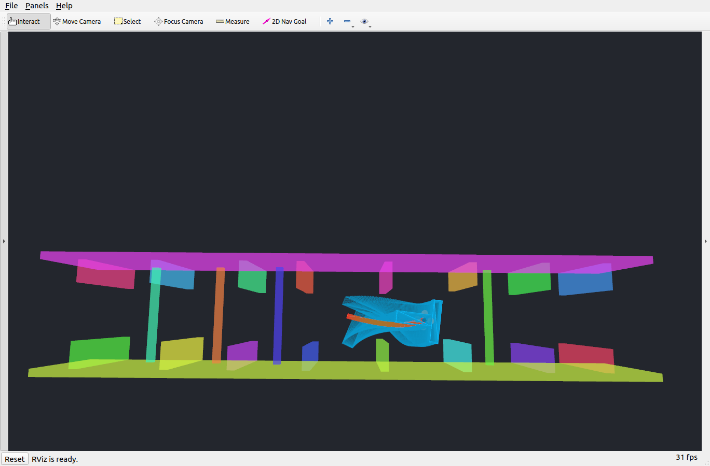

# Release validation

Checked on 18 November 2026 in the independent release workspace, with Ubuntu 20.04, ROS1 Noetic, system Python 3.8, and GCC 9.4. No planner algorithm or motion-limit parameters were changed during extraction.

## Build and regression checks

- `bash mighty_ws/src/mighty/setup.sh -j 4`: passed for the new workspace (`dynus_interfaces` and `mighty`, plus Catkin prebuild).
- FCL 0.7.0 and JSON 3.10.5 were built in the release workspace from cached source archives; the setup script verified the archives against its pinned checksums. Old dependency binaries and old workspace build products were not reused. Internet download was not exercised in this run.
- `ctest --output-on-failure` from `mighty_ws/build/mighty`: **4/4 passed** (`whole_body_gradient`, `yaw_variation_gradient`, `planner_regressions`, `noetic_config`). The configuration suite checks all 18 supported map/shape combinations; it does not execute all 18 combinations in ROS.

## Real ROS node execution

Ran the shipped `test/validate_noetic_runtime.py --representatives-only` against an isolated ROS master on port 11321, using the released assets and newly built executables. These are actual ROS planner and fake-simulator nodes with ROS topic transport.

| Task | Executable trajectories | Moving state samples | Arrival | Endpoint yaw error (rad) |
| --- | ---: | ---: | --- | ---: |
| `narrow-t` | 1 | 481 | Yes | 0.0000 |
| `block-t` | 1 | 645 | Yes | 0.0000 |
| `forest-v` | 1 | 1130 | Yes | 0.0000 |
| `hole-cross` | 1 | 986 | Yes | 0.0000 |

All four cases loaded their map and shape, published nonempty latched map geometry to subscribers created after startup, generated frontend and backend trajectories, moved the simulated body, reached the goal, and removed their ROS nodes on exit. The narrow-map check also observed both floor and ceiling display markers. The validator compared measured terminal yaw with the simulator's final command; these representative tasks leave the choice of terminal yaw to the planner.

Machine-readable results: [validation-results.json](validation-results.json). Each representative runs only the first start/goal pair of its fixture; this is not the full benchmark suite.

## RViz display

A separate GUI smoke test used the released `narrow` map and `t` body on isolated ROS master port 11322. The actual RViz window was opened and inspected; it displayed the obstacle map, planned trajectory, and swept body geometry. The task from `(0, 0, 1)` to `(2.27, -0.11, 1)` reached its goal, with 109 backend trajectory samples and 481 moving state samples. The owned planner, simulator, RViz, and ROS master processes were cleaned up afterward.

## Limits

This release check covers compilation, selected regressions, and four simulated ROS executions. It does not establish real-hardware performance, exhaustive map/shape coverage, continuous-time collision guarantees, or reproduction of all paper experiments. The shipped geometry is ready for loading; the excluded map and shape construction pipeline was not tested as part of the release.
